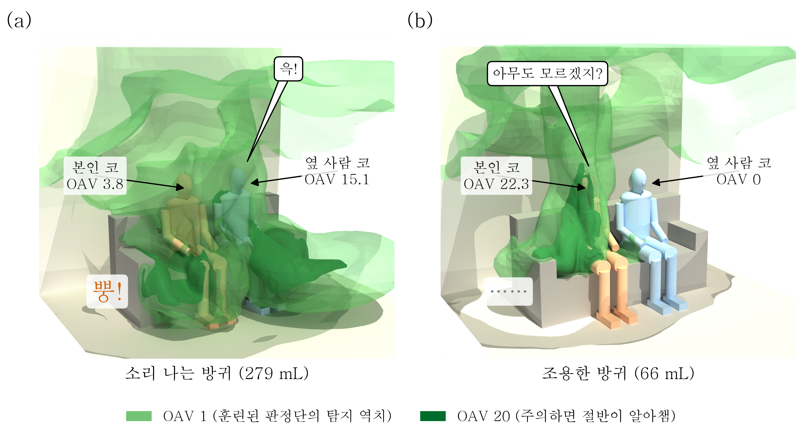

# 소리 없는 방귀는 정말 더 독한가: 성분·확산·지각 문헌과 실내 기류 시뮬레이션을 통한 검증

조찬영 · 작성일 2026년 10월 27일

<!-- 본문(초록~결론) 분량은 count_chars.py로 확인. -->

## 초록

"소리 없는 방귀가 더 독하다"는 통념이 곁에 있는 사람이 실제로 맡는 냄새와 맞는지 검토하였다. 방귀 냄새의 성분, 몸 주변 기류에 의한 확산, 냄새 지각과 기억의 세 주제로 문헌 25편(비공식 자료 1편 포함)을 비교하고, 문헌이 답하지 못하는 부분은 저자가 수행한 미출간 전산유체역학(CFD) 시뮬레이션으로 보완하였다. 성분 문헌에 따르면 냄새를 내는 황화합물의 농도는 소리와 무관한 요인으로 정해지며, 소리와 냄새를 함께 기록한 유일한 자료(비공식)에서는 소리가 클수록 냄새가 아주 조금 더 강하였다. 시뮬레이션에서 조용한 방귀는 체온으로 생기는 몸의 상승 흐름을 타고 방귀를 뀐 사람 쪽으로 올라가, 옆 사람의 코를 비껴가는 경우가 많았다. 사람들이 각 상황에 머무는 시간을 반영해 계산하면, 옆 사람에게 조용한 방귀가 더 독하게 느껴지는 경우는 0.4%, 소리 나는 방귀가 더 독한 경우는 6.8%였다. 그런데 조용한 방귀는 냄새를 맡았을 때에만 뀌었다는 사실을 알게 되므로, 기억에 남는 비교로 한정하면 91.5%가 "조용한 쪽이 더 독했다"가 되었다. 따라서 이 통념은 옆 사람이 실제로 맡는 냄새에 대해서는 대체로 틀렸으며, 기억이 선택적으로 남는 방식이 이 믿음을 만든다고 판단한다. 조용한 방귀가 몸 가까이 머무는 앉은 자세에서는 뀐 사람 본인이 그 냄새를 맡는 경우가 늘어나지만, 이때에도 소리 나는 방귀가 더 자주 독하였다.

## 제1장 서론

### 제1절 연구의 배경과 목적

조용한 방귀가 더 독하다는 믿음은 오래되었고 널리 퍼져 있다. 영어에서는 적어도 1970년부터 "silent but deadly(조용하지만 치명적인)"라는 표현이 쓰였고, 영화 「세 얼간이」에도 소리 없이 지독한 방귀를 뀌는 인물이 조용한 쪽이 가장 치명적이라고 말하는 장면이 나온다. 한국어에도 "소리 없는 방귀가 더 독하다"는 말이 있다. 1811년 영국의 속어 사전(Grose 1811)은 비슷한 낱말을 "귀보다 코로 더 분명히 알게 되는" 방귀로 풀이하였다. 저자가 32개 언어의 사전과 속담을 조사한 결과(미출간), 조용한 방귀와 소리 나는 방귀를 구분하는 낱말은 적어도 다섯 어족에 있었고, 조용한 쪽이 더 고약하다는 주장은 중국어와 영어 속담에 분명히 나타났다. 서로 독립된 문화에서 같은 믿음이 생겼다면 그 원인은 사람에게 공통된 무엇일 가능성이 크다. 그러나 이 주장을 직접 검증한 연구는 찾지 못하였다.

통념을 이루는 두 표현은 모두 뜻이 넓다. "소리 없는"은 괄약근이 떨리지 않아 실제로 소리가 나지 않은 경우와, 소리가 났지만 주변 소음에 묻혀 들리지 않은 경우를 모두 가리킨다. "독하다"도 코에 닿는 농도의 최댓값, 들이마신 총량, 기억에 남은 인상 가운데 어느 것이든 될 수 있다. 이 글에서는 "독하다"를 **사람이 냄새로 느끼는 세기**로 정의한다. 냄새를 맡지 못한 방귀는 독함을 0으로 보고, 두 방귀를 모두 맡았다면 사람이 냄새 세기의 차이를 구별할 수 있는 최소 차이(약 28%)보다 더 강한 쪽을 더 독하다고 본다.

이 글의 연구 질문은 다음과 같다. **한 사람이 실제로 뀌는 방귀들 가운데, 곁에 있는 사람에게 조용한 방귀가 소리 나는 방귀보다 더 독하게 느껴지는 경우가 더 많은가?** 이 질문에 답하려면 방귀의 성분에서 출발해 공기 중 확산을 거쳐 사람의 지각과 기억까지 차례로 따라가야 한다. 아래에서는 방귀를 뀐 사람을 '뀐 사람', 곁에 앉거나 서 있는 사람을 '옆 사람'이라 부른다.

### 제2절 검토한 문헌과 방법

**연구의 범위.** 건강한 성인의 방귀 성분과 양, 방귀 소리가 나는 원리, 사람 몸 주변의 대류 기류와 몸 가까이에서 나온 오염물의 노출, 냄새를 알아차리는 최소 농도(탐지 역치)와 주의, 착각 상관과 선택 편향을 다룬 동료 심사 문헌을 검토하였다. 출판 연도는 제한하지 않았으며, 검토한 문헌은 1946–2021년에 출판되었다. 방귀의 소리와 냄새를 함께 기록한 자료는 동료 심사를 거치지 않은 1건뿐이어서, 비공식 자료로 따로 표시하여 포함하였다.

**연구의 방법.** 문헌은 OpenAlex와 PubMed에서 "flatus odour", "flatus composition", "human convective boundary layer", "odor threshold", "olfactory attention", "illusory correlation", "Berkson bias" 등의 검색어로 2026년 10월에 검색하였다. 연구 초기의 문헌 탐색에는 라이너 스콜라를 사용하였다. 모든 문헌의 서지정보는 DOI로 대조하였고, 인용한 수치는 초록이나 원문에서 확인하였다.

문헌이 직접 답하지 못하는 부분, 곧 "뀐 방귀가 옆 사람의 코에 얼마나 닿는가"는 저자가 수행한 미출간 시뮬레이션으로 보완하였다. 오픈소스 전산유체역학 프로그램 OpenFOAM으로 소파에 나란히 앉은 두 사람(세 가지 자세)과 마주 선 두 사람(바람이 없는 방, 사무실 환기)의 실내 기류를 계산하였다. 소리 나는 방귀와 조용한 방귀를 각각 분출 세기가 다른 두 가지씩 넣고, 방귀를 뀐 뒤 150초 동안 각 사람이 한 번 숨을 들이쉴 때 코로 들어오는 농도의 최댓값을 구하였다. 농도는 냄새 활성값(OAV)으로 나타냈는데, 이는 농도가 탐지 역치의 몇 배인지를 뜻한다. OAV 1은 훈련된 판정단이 겨우 알아채는 농도이다. 다음으로 문헌에서 얻은 방귀의 양과 분출 조건의 분포에서 방귀 2만 건을 무작위로 뽑아 계산하였고(몬테카를로 계산), 상황별 결과는 사람들이 하루 중 그 상황에 머무는 시간에 비례하여 합산하였다. 냄새를 맡는 사람은 냄새에 주의를 기울이는 사람(OAV 20에서 절반이 알아챔)과 다른 일에 몰두한 사람(OAV 520에서 절반이 알아챔)의 두 경우로 나누었다. 이 시뮬레이션은 동료 심사를 거치지 않았고 시간에 따라 평균한 기류만 계산하였으므로, 본문에서는 문헌 근거와 구분하여 "시뮬레이션"으로 표시한다.

## 제2장 주제별 분석

### 제1절 성분: 소리와 냄새 물질은 따로 정해진다

**공통 결과.** 방귀 냄새는 미량의 황화합물이 결정한다. Suarez 등(1998)은 건강한 성인의 방귀에서 황화수소(평균 1.06 µmol/L), 메탄싸이올(0.21 µmol/L), 다이메틸설파이드(0.08 µmol/L)를 측정하였고, 판정자가 매긴 악취 점수는 황화수소 농도와 유의한 상관을 보였다. Tangerman(2009)도 이 세 황화합물을 주된 냄새 물질로 정리하였다. 반면 방귀 부피의 대부분은 장내 발효로 생기는 수소, 이산화탄소, 메탄과 삼킨 공기의 질소가 차지한다. Suarez 등(1997)에 따르면 장 안에서 생긴 가스가 방귀의 약 74%를 차지하며, 가장 많은 가스의 종류도 사람마다 달랐다. 하루 방귀량은 476–1491 mL(중앙값 705 mL)였고, 식이섬유를 뺀 식단에서는 하루 214 mL로 줄었다(Tomlin 등 1991). 하루 배출 횟수가 약 10회이므로(Furne & Levitt 1996) 한 번에 수십 mL가 나오는 셈이다. 냄새 물질은 다른 가스와 달리 쉽게 흡착된다. 숯을 넣은 방석은 황 가스를 90% 이상 흡수하였고(Suarez 등 1998), 평범한 옷도 30초 동안 황화물 가스의 약 22%를 걸러 냈다(Ohge 등 2005). 결국 냄새의 세기는 방귀의 양뿐 아니라 미량 성분의 농도와, 그 성분이 옷이나 가구를 지나며 얼마나 남는지에 크게 달려 있다.

**차이와 한계.** 소리는 이와 다른 경로로 정해진다. 방귀 소리는 항문 피부가 트럼펫 연주자의 입술처럼 떨려서 난다고 보고되었으나(Ancalle 등 2021), 학회 초록이어서 측정 자료는 제시되지 않았다. 피부가 떨리는지는 분출 압력과 속도, 곧 한 번에 나오는 양과 빠르기에 달려 있으며 황화합물 농도와는 직접 관련이 없다. 성분 연구는 모두 직장 튜브로 모은 시료를 분석하였으므로 방귀 한 번 한 번의 소리를 기록하지 않았다. 소리와 냄새를 함께 잰 자료는 동료 심사를 거치지 않은 개인 기록 1건뿐이다. 이 기록은 방귀 1,619건을 녹음하고 가스 센서로 냄새를 쟀는데, 소리가 클수록 냄새가 아주 조금 더 강했으며(소리 크기가 냄새 차이의 1.6%만 설명) 소리 없는 방귀는 하나도 기록되지 않았다(Snyder 2020).

**표 1.** 성분 단계 문헌의 비교

| 문헌 | 대상과 방법 | 주요 결과 | 소리와의 관계 |
|---|---|---|---|
| Suarez 등 1998 | 건강한 성인, 직장 튜브 채집, 가스 분석과 냄새 판정 | 악취는 황화수소 농도와 가장 강하게 상관 | 기록하지 않음 |
| Suarez 등 1997 | 건강한 성인, 방귀 성분 분석 | 장내 생성 가스가 약 74%, 주된 가스는 사람마다 다름 | 기록하지 않음 |
| Tomlin 등 1991 | 건강한 자원자, 24시간 채집 | 하루 476–1491 mL, 식단에 따라 크게 변함 | 기록하지 않음 |
| Furne & Levitt 1996 | 건강한 성인, 배출 횟수 기록 | 하루 약 10회(정상 상한 20회) | 기록하지 않음 |
| Ohge 등 2005 | 옷과 냄새 차단 제품의 황화물 제거율 | 평범한 옷은 약 22% 제거 | 해당 없음 |
| Snyder 2020 (비공식) | 개인 기록 1,619건, 녹음과 가스 센서 | 소리가 클수록 냄새가 약간 강함 | 설명력 1.6%, 조용한 방귀 기록 없음 |

**종합.** 성분 문헌에는 "조용한 방귀일수록 황화합물이 진하다"는 근거가 없다. 농도가 같다면 대체로 양이 많은 소리 나는 방귀가 냄새 물질도 더 많이 내보낸다. 그런데도 통념이 맞으려면 조용한 방귀가 덜 묽어진 채로 코에 닿아야 한다. 다음 절에서 이 문제를 다룬다.

### 제2절 확산: 코까지 냄새를 나르는 것은 몸 주변 기류다

**공통 결과.** 빠르게 분출되는 기체는 주변 공기를 끌어들이며 묽어지고, 분출 방향 중심선의 농도는 거리에 반비례하여 줄어든다(Dowling & Dimotakis 1990). 이 원리만 보면 천천히 새어 나오는 조용한 방귀가 덜 묽어져 더 독할 것 같다. 저자가 함께 사용한 단순 모델은 기류의 경로를 무시하고 분출된 기체가 퍼지며 묽어지는 정도만 계산하는데(코가 기체 덩어리의 중심에 있다고 가정), 이 모델에서는 실제로 뀌는 양을 기준으로 조용한 쪽의 농도가 더 높은 경우가 48%로 거의 절반이었다. 그러나 실내에서는 사람의 몸 자체가 기류를 만든다. 체온으로 데워진 공기는 몸 표면을 따라 올라가는 얇은 층(대류 경계층)을 이룬다. 앉은 사람 앞에서 이 흐름의 속도는 최대 약 0.16–0.24 m/s에 이르고, 흐름은 숨 쉬는 높이까지 이어진다(Licina 등 2014). 그래서 몸 가까이에서 나온 오염물은 이 흐름을 타고 올라가며, 같은 양이 방의 다른 곳에서 나올 때보다 그 사람이 들이마시는 양이 훨씬 많다(Rim & Novoselac 2009, 2010; Licina 등 2017). 옷도 이 흐름을 바꾸어, 두껍고 헐렁한 옷은 숨 쉬는 높이의 상승 속도를 약 40% 줄였다(Licina 등 2014).

**차이.** 기존 연구는 대부분 저절로 퍼지는 오염원과 그 사람 자신의 노출을 다루었다. 조용한 방귀는 이런 오염원에 가깝지만 소리 나는 방귀는 빠른 분출이다. 또 통념이 말하는 피해자는 뀐 사람이 아니라 옆 사람이다. 위에서 내려오는 환기 기류가 몸의 상승 흐름과 부딪히면 코 앞의 상승 속도가 0.185 m/s에서 0.10 m/s로 줄었다는 결과(Licina 등 2015)처럼, 기체가 가는 길은 자세와 환기에 따라 달라진다.

**시뮬레이션 보완.** 시뮬레이션에서 기체의 경로를 가른 것은 방귀의 분출 세기와 몸의 상승 흐름 세기의 비였다. 분출이 상승 흐름보다 약하면 기체는 흐름에 실려 올라갔고, 수백 배 세면 흐름을 뚫고 나갔다. 소파에 앉은 경우 가장 느린 조용한 방귀는 흐름에 실려 뀐 사람 쪽으로 올라갔고, 옆 사람의 코에는 아주 적은 양만 닿았다. 반면 가장 센 소리 나는 방귀는 흐름을 뚫고 나가 옆 사람의 코까지 닿았다. 바른 자세로 앉은 경우 옆 사람 코의 OAV는 센 소리 나는 방귀에서 16.9, 센 조용한 방귀에서 0.09였다. 옷을 입히지 않은 다섯 가지 상황 모두에서, 옆 사람 코에서 탐지 역치(OAV 1)를 넘긴 조용한 방귀는 없었다. 사람 모형에 바지를 입히면 오히려 소리 나는 방귀의 냄새가 더 강해졌다.

그림 1은 같은 자세, 같은 시각에서 두 방귀를 비교한 것이다. 소리 나는 방귀는 옆 사람의 코에 OAV 15로 닿았고, 뀐 사람의 코에서는 3.8이었다. 조용한 방귀는 정반대로 뀐 사람의 코에서 OAV 22, 옆 사람의 코에서 0이었다. 조용한 방귀가 몸의 상승 흐름을 타고 뀐 사람을 감싸며 천장까지 올라가는 모습이 그림에 그대로 드러난다. 마주 선 두 사람에서는 방귀의 종류와 관계없이 옆 사람 코의 농도가 낮았다. 서 있으면 엉덩이에서 코까지의 높이 차가 크고, 상대가 뀐 사람의 뒤가 아니라 앞에 있기 때문이다. 따라서 분출 세기만으로 경로가 모두 정해지지는 않으며, 사람 사이의 배치와 거리도 함께 작용한다.

**그림 1.** 소파에 약간(4.5°) 기대앉은 두 사람(뀐 사람 주황, 옆 사람 파랑)과 방귀를 뀐 지 약 30초 뒤의 냄새 구름. (a) 소리 나는 방귀(279 mL), (b) 조용한 방귀(66 mL). 두 방귀는 각 종류에서 분출 세기가 상위 10%에 드는 대표 사례이다. 연한 초록 면과 진한 초록 면은 각각 OAV가 1(훈련된 판정단의 탐지 역치)과 20(주의를 기울이는 사람의 절반이 알아챔)인 지점을 이은 면이고, 숫자는 그 순간 코 위치의 OAV이다. 출처: 저자 시뮬레이션(OpenFOAM), ParaView로 렌더링.

### 제3절 지각과 기억: 조용한 방귀는 냄새를 맡았을 때만 기억된다

**공통 결과.** 일반인의 냄새 탐지 역치는 훈련된 판정단보다 약 20배 높고(Amoore & Hautala 1983), 같은 사람이라도 순간마다 크게 달라진다(Stevens 등 1988). 냄새를 예상하지 못한 사람은 역치의 약 26배 농도가 되어야 절반이 반응한다(Whisman 등 1978; Amoore & Hautala 1983). 눈으로 하는 일에 주의를 빼앗기면 냄새를 알아차리지 못하는 상태가 꽤 오래 이어지고(Forster & Spence 2018), 직전에 냄새에 노출되었는지에 따라 탐지 역치가 최대 천 배까지 달라지기도 한다(Greenberg 등 2013). 대화나 텔레비전에 빠져 있는 거실의 옆 사람은 대개 이처럼 주의를 빼앗긴 상태에 가깝다. 다만 주의가 달라져도 처음 느끼는 냄새의 세기 자체는 크게 달라지지 않았다(Fallon 등 2018). 소리와 기대도 냄새 판단을 바꾼다. 함께 들리는 소리는 냄새가 좋고 나쁜 정도의 평가를 바꾸고(Seo & Hummel 2011), 냄새가 해롭다는 믿음은 사람들이 느끼는 세기와 증상 보고를 높인다(Dalton 1996).

**선택 편향.** 핵심은 무엇이 기억에 남느냐이다. 소리 나는 방귀는 냄새를 맡지 못해도 소리로 알 수 있지만, 조용한 방귀는 냄새를 맡았을 때에만 뀌었다는 사실을 안다. 따라서 기억 속의 조용한 방귀는 처음부터 "냄새가 난 것"만 모인 표본이다. 이처럼 두 경로 가운데 하나로 알아챈 사건만 모으면, 실제로는 관련이 없는 두 성질(소리가 없음과 냄새가 지독함)이 관련 있어 보인다. 이를 Berkson(1946)의 선택 편향이라 한다(Snoep 등 2014). 또 드물고 눈에 띄는 조합(조용한데 지독함)은 실제보다 자주 일어났다고 기억되고(Hamilton & Gifford 1976), 사람들은 그럴듯한 연관을 실제 자료와 상관없이 보고한다(Chapman 1967).

**시뮬레이션 보완.** 앞 절의 상황에 방귀 2만 건을 적용하여, 같은 방귀들에 대해 실제로 맡는 냄새와 기억에 남는 비교를 함께 계산하였다(표 2). 2만 건 가운데 약 85%는 괄약근이 떨리지 않는 조용한 방귀였으며, 이 비율은 분출 조건에 대한 가정에 따라 76–94% 사이에서 달라졌다.

**표 2.** 옆 사람이 조용한 방귀와 소리 나는 방귀를 하나씩 겪었을 때 어느 쪽이 더 독한가 (옷을 입히지 않은 계산, 상황별로 머무는 시간에 비례하여 합산, 단위 %, 기억에 남은 비교는 기억된 쌍만을 100%로 한 비율, 출처: 저자 시뮬레이션)

| 냄새를 맡는 사람 | 비교 기준 | 둘 다 못 맡음 | 조용한 쪽이 더 독함 | 소리 나는 쪽이 더 독함 | 차이를 구별 못 함 |
|---|---|---|---|---|---|
| 주의를 기울이는 사람 | 실제로 맡는 냄새 | 92.8 | 0.4 | 6.8 | 0.0 |
| 주의를 기울이는 사람 | 기억에 남은 비교 | – | 91.5 | 7.7 | 0.9 |
| 다른 일에 몰두한 사람 | 실제로 맡는 냄새 | 98.5 | 0.1 | 1.4 | 0.0 |
| 다른 일에 몰두한 사람 | 기억에 남은 비교 | – | 98.2 | 1.7 | 0.1 |

실제로는 소리 나는 쪽이 더 독한 경우가 약 17배 많지만, 기억 속에서는 조용한 쪽이 더 독했다는 비교가 90% 이상을 차지한다. 모든 방귀의 냄새를 맡는다고 가정하면 기억 속 비율은 실제 비율(약 29%)까지 내려간다. 즉 이 결과는 계산 방식 때문에 저절로 나오는 값이 아니라, 냄새를 드물게 맡는다는 현실 조건에서 생기는 효과이다.

## 제3장 논의

**표 3.** 단계별 근거의 종합

| 단계 | 문헌 근거 | 저자 시뮬레이션 | 통념에 대한 판단 |
|---|---|---|---|
| 성분 | 냄새는 황화합물 농도가 정하며 소리와 직접 관련이 없음(간접 근거) | 다루지 않음 | 지지 근거 없음 |
| 확산 | 몸 주변 상승 흐름이 가까운 오염물을 그 사람의 호흡 높이로 나름 | 조용한 방귀는 옆 사람 코를 비껴감 | 옆 사람에게는 반대 |
| 지각과 기억 | 주의와 선택 편향 때문에 드물고 눈에 띄는 조합이 과대 기억됨 | 기억된 비교의 91.5%가 조용한 쪽 | 믿음이 생기는 원인을 설명 |

세 주제의 근거는 한 방향을 가리킨다. 성분 문헌은 소리와 냄새 물질이 따로 정해진다는 것을, 확산 문헌과 시뮬레이션은 조용한 방귀가 옆 사람보다 뀐 사람 쪽으로 간다는 것을 보여 준다. 그리고 지각 문헌은 그런데도 왜 반대의 믿음이 생기는지를 설명한다. 연구마다 결과가 엇갈리는 지점은 대개 "누구의 코인가"와 "무엇을 기준으로 비교하는가"의 차이에서 온다. 기류의 경로를 무시한 단순 모델에서는 조용한 쪽의 농도가 더 높은 경우가 48%로 거의 반반이었지만, 경로를 반영한 시뮬레이션에서는 옆 사람에게 조용한 쪽이 더 독하게 느껴지는 경우가 0.4%에 그쳤다. 뀐 사람 본인의 코에서는 조용한 쪽이 더 독한 경우가 4.6%로 옆 사람보다 열 배 이상 많았는데(소리 나는 쪽은 17.9%), 앉은 자세에서 조용한 방귀가 몸의 상승 흐름을 타고 본인 얼굴로 올라오기 때문이다. 그래도 본인의 코에서조차 소리 나는 쪽이 더 자주 독하였다. 상황별로는 마주 선 두 사람에서만 조용한 쪽이 근소하게 앞섰으나(0.04% 대 0.00%), 이는 99.96%의 비교에서 둘 다 냄새를 맡지 못하는 수준의 차이이다.

결론이 가정에 따라 얼마나 달라지는지도 확인하였다. 냄새를 맡을 확률이 농도에 따라 얼마나 가파르게 변하는지, 그리고 아주 옅은 농도에서 그 확률을 어떻게 가정하는지를 바꾸어도, 소리 나는 쪽이 더 독한 경우가 4–111배 많았고 기억 속에서 조용한 쪽이 더 독했다는 비율은 62–100%였다. 방귀가 나오는 시간, 항문이 열리는 크기, 소리가 나기 시작하는 압력을 바꾼 경우에도 결론의 방향은 같았다. 또 시뮬레이션은 시간에 따라 평균한 농도를 계산하므로 순간적으로는 농도가 더 치솟을 수 있다. 그러나 조용한 방귀에서만 순간 최고 농도가 평균의 약 14배에 이르러야 결과가 뒤집힌다.

근거의 수준은 단계마다 다르다. 성분과 지각 단계에서는 여러 실험 연구가 같은 방향을 가리키지만 방귀를 직접 다룬 연구는 적고, 확산 단계에서 방귀를 직접 다룬 근거는 저자의 시뮬레이션뿐이다. 또 통념은 개인의 경험만으로 생기지 않는다. 사람들은 그럴듯한 연관이라면 자료와 상관없이 믿고 보고하므로(Chapman 1967), 한번 말로 굳어진 통념과 각자의 기억 편향이 서로를 강화하며 전해질 수 있다.

이 결론에는 한계가 있다. 첫째, 방귀 한 번마다 소리와 냄새를 함께 측정한 동료 심사 연구가 없어 성분 단계의 근거는 간접적이다. 둘째, 시뮬레이션은 동료 심사를 거치지 않았고 시간에 따라 평균한 기류만 계산하였다. 순간적인 흐름의 변동까지 푸는 계산과 엘리베이터 상황의 계산은 아직 진행 중이며, 앉은 사람의 상승 흐름을 실측보다 40–56% 빠르게 예측한다는 점도 확인하였다. 셋째, 탐지 확률이 50%보다 낮은 옅은 농도에서는 측정 자료의 범위 밖으로 외삽하였다. 넷째, 기억의 선택 편향은 이 믿음을 설명할 수 있음을 보인 것이며 설문으로 검증하지는 않았다. 이 설명이 맞다면 후각을 잃은 사람이나 뀐 사람 본인은 이 통념을 덜 믿을 것이므로, 설문으로 이를 확인해 볼 수 있다. 다른 상황으로 넓혀 적용할 때에는 자세, 환기, 사람 사이의 거리에 따라 경로가 달라진다는 점을 고려해야 한다.

## 제4장 결론

"소리 없는 방귀가 더 독하다"는 통념은 곁에 있는 사람이 실제로 맡는 냄새에 대해서는 대체로 틀렸다. 냄새 물질은 소리와 따로 정해지고, 조용한 방귀는 몸의 상승 흐름을 타고 올라가 옆 사람의 코를 비껴가는 경우가 많다. 사람들이 각 상황에 머무는 시간을 반영하면, 옆 사람에게는 소리 나는 방귀가 더 독한 경우가 조용한 방귀보다 약 17배 많다. 그런데도 이 믿음이 널리 퍼진 것은 조용한 방귀가 냄새를 맡았을 때만 기억에 남기 때문이다. 이 선택 편향만으로도 기억 속 비교의 90% 이상이 "조용한 쪽이 더 독했다"가 된다. 곧 실제로 맡는 냄새로는 드문 일이 기억 속에서는 대부분이 된다. 조용한 방귀가 더 독한 경우가 가장 많아지는 것은 앉은 자세에서 뀐 사람 본인의 코처럼 조용한 방귀가 몸 가까이 머무는 경우이지만, 이때에도 소리 나는 방귀가 더 자주 독하다.

## 참고문헌

- Amoore, J. E., & Hautala, E. (1983). Odor as an aid to chemical safety: odor thresholds compared with threshold limit values and volatilities for 214 industrial chemicals in air and water dilution. *Journal of Applied Toxicology*, 3(6), 272–290. https://doi.org/10.1002/jat.2550030603
- Ancalle, D. S., Finn, C. L., Jiang, N., Stewart, S. A., & Hu, D. L. (2021). Physics of flatulence. *Journal of the Acoustical Society of America*, 150(4_Supplement), A164 (학회 초록). https://doi.org/10.1121/10.0007996
- Berkson, J. (1946). Limitations of the application of fourfold table analysis to hospital data. *Biometrics Bulletin*, 2(3), 47–53. https://doi.org/10.2307/3002000
- Chapman, L. J. (1967). Illusory correlation in observational report. *Journal of Verbal Learning and Verbal Behavior*, 6(1), 151–155. https://doi.org/10.1016/S0022-5371(67)80066-5
- Dalton, P. (1996). Odor perception and beliefs about risk. *Chemical Senses*, 21(4), 447–458. https://doi.org/10.1093/chemse/21.4.447
- Dowling, D. R., & Dimotakis, P. E. (1990). Similarity of the concentration field of gas-phase turbulent jets. *Journal of Fluid Mechanics*, 218, 109–141. https://doi.org/10.1017/S0022112090000945
- Fallon, N. B., Giesbrecht, T., & Stančák, A. (2018). Attentional modulation of desensitization to odor. *Attention, Perception, & Psychophysics*, 80, 1064–1071. https://doi.org/10.3758/s13414-018-1539-2
- Forster, S., & Spence, C. (2018). "What smell?" Temporarily loading visual attention induces a prolonged loss of olfactory awareness. *Psychological Science*, 29(10), 1642–1652. https://doi.org/10.1177/0956797618781325
- Furne, J. K., & Levitt, M. D. (1996). Factors influencing frequency of flatus emission by healthy subjects. *Digestive Diseases and Sciences*, 41(8), 1631–1635. https://doi.org/10.1007/BF02087912
- Greenberg, M. I., Curtis, J. A., & Vearrier, D. (2013). The perception of odor is not a surrogate marker for chemical exposure: a review of factors influencing human odor perception. *Clinical Toxicology*, 51(2), 70–76. https://doi.org/10.3109/15563650.2013.767908
- Grose, F. (1811). *Dictionary of the Vulgar Tongue*. London (항목 'fice', 공유 저작물).
- Hamilton, D. L., & Gifford, R. K. (1976). Illusory correlation in interpersonal perception: a cognitive basis of stereotypic judgments. *Journal of Experimental Social Psychology*, 12(4), 392–407. https://doi.org/10.1016/S0022-1031(76)80006-6
- Licina, D., Pantelic, J., Melikov, A., Sekhar, C., & Tham, K. W. (2014). Experimental investigation of the human convective boundary layer in a quiescent indoor environment. *Building and Environment*, 75, 79–91. https://doi.org/10.1016/j.buildenv.2014.01.016
- Licina, D., Melikov, A., Sekhar, C., & Tham, K. W. (2015). Human convective boundary layer and its interaction with room ventilation flow. *Indoor Air*, 25(1), 21–35. https://doi.org/10.1111/ina.12120
- Licina, D., Tian, Y., & Nazaroff, W. W. (2017). Inhalation intake fraction of particulate matter from localized indoor emissions. *Building and Environment*, 123, 14–22. https://doi.org/10.1016/j.buildenv.2017.06.037
- Rim, D., & Novoselac, A. (2009). Transport of particulate and gaseous pollutants in the vicinity of a human body. *Building and Environment*, 44(9), 1840–1849. https://doi.org/10.1016/j.buildenv.2008.12.009
- Rim, D., & Novoselac, A. (2010). Ventilation effectiveness as an indicator of occupant exposure to particles from indoor sources. *Building and Environment*, 45(5), 1214–1224. https://doi.org/10.1016/j.buildenv.2009.11.004
- Seo, H.-S., & Hummel, T. (2011). Auditory-olfactory integration: congruent or pleasant sounds amplify odor pleasantness. *Chemical Senses*, 36(3), 301–309. https://doi.org/10.1093/chemse/bjq129
- Snoep, J. D., Morabia, A., Hernández-Díaz, S., Hernán, M. A., & Vandenbroucke, J. P. (2014). Commentary: a structural approach to Berkson's fallacy and a guide to a history of opinions about it. *International Journal of Epidemiology*, 43(2), 515–521. https://doi.org/10.1093/ije/dyu026
- Snyder, W. (2020, 2022 갱신). The sound of stink. flatology.com (블로그, 동료 심사 없음). https://flatology.com/the-sound-of-stink/
- Stevens, J. C., Cain, W. S., & Burke, R. J. (1988). Variability of olfactory thresholds. *Chemical Senses*, 13(4), 643–653. https://doi.org/10.1093/chemse/13.4.643
- Suarez, F. L., Furne, J. K., Springfield, J., & Levitt, M. D. (1997). Insights into human colonic physiology obtained from the study of flatus composition. *American Journal of Physiology – Gastrointestinal and Liver Physiology*, 272(5), G1028–G1033. https://doi.org/10.1152/ajpgi.1997.272.5.G1028
- Suarez, F. L., Springfield, J. R., & Levitt, M. D. (1998). Identification of gases responsible for the odour of human flatus and evaluation of a device purported to reduce this odour. *Gut*, 43(1), 100–104. https://doi.org/10.1136/gut.43.1.100
- Tangerman, A. (2009). Measurement and biological significance of the volatile sulfur compounds hydrogen sulfide, methanethiol and dimethyl sulfide in various biological matrices. *Journal of Chromatography B*, 877, 3366–3377. https://doi.org/10.1016/j.jchromb.2009.05.026
- Tomlin, J., Lowis, C., & Read, N. W. (1991). Investigation of normal flatus production in healthy volunteers. *Gut*, 32(6), 665–669. https://doi.org/10.1136/gut.32.6.665
- Whisman, M. L., Goetzinger, J. W., & Cotton, F. O. (1978). Odorant evaluation: a study of ethanethiol and tetrahydrothiophene as warning agents in propane. *Environmental Science & Technology*, 12, 1285–1288. https://doi.org/10.1021/es60147a003
- 조찬영 (2026). 미출간 시뮬레이션: OpenFOAM 13을 이용한 소파와 서 있는 두 사람 주변의 방귀 확산 계산과 몬테카를로 계산. 동료 심사 전.
